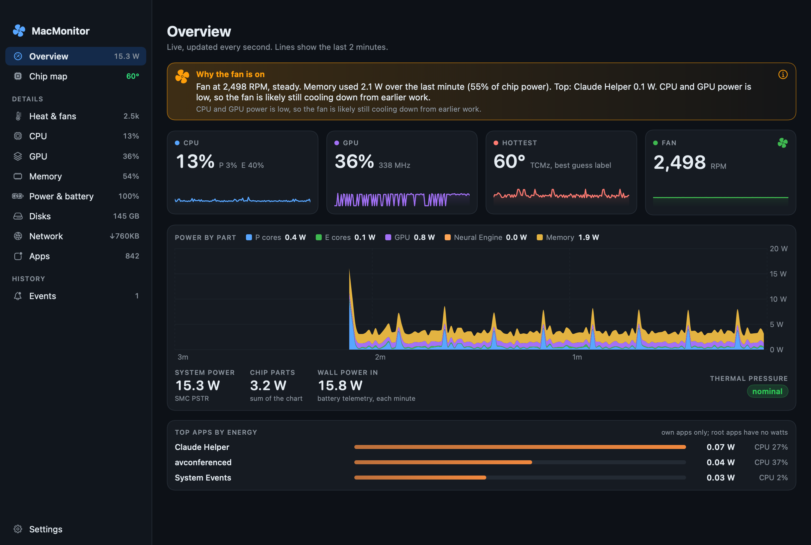

# MacMonitor

**MCP for your Mac hardware.** Works with Claude and Codex.

MacMonitor is a free, open-source Mac app that shows what your Mac's hardware is doing, live.
It answers one question first: **why is my fan on right now?**

It lives in the menu bar, opens a window full of live graphs, keeps history, sends alerts,
and lets AI agents like Claude and Codex read the same data through an MCP server.

It reads hardware sensors read only. It never writes to the hardware and never needs an admin password.
It only connects to GitHub, about once a day, to check for a new version. It sends nothing about your Mac.
You can turn this off in Settings.



## Which Macs it works on

- **Built for Apple Silicon Macs** (M-series chips).
- **Tested on one Mac:** a MacBook Pro with an M4 Pro chip, on macOS 26.
- **Needs macOS 15 or newer** to build and run.
- On other Apple Silicon chips it should run, but some sensor names, the chip map drawing and the core layout are tuned
  for the M4 Pro. A reading it cannot find shows "not available" instead of a wrong number.
- Intel Macs are not supported.

## What you get

- **Menu bar:** a tiny CPU graph plus `CPU 42% · 71° · 2.3k` (CPU, hottest temperature, fan RPM).
  Click it for key numbers, the fan headline and an "Open MacMonitor" button.
- **Overview:** CPU, GPU, hottest temperature and fan tiles with moving graphs, power by chip part,
  system and wall power, thermal pressure, and the top apps by energy.
- **Chip map:** a drawing of the M4 Pro chip. Each block glows blue (40°) to red (100°) with its live
  temperature. One bar per core (10 P cores, 4 E cores), with clocks and watts.
- **Detail pages:** Heat & fans, CPU, GPU, Memory, Power & battery, Disks, Network, Apps.
  Click a row to open its history chart (15 minutes, 1 hour, 24 hours or 30 days).
- **Events:** fan ramps, heat, throttle signs, memory, swap, disk, SSD, battery flag and wake.
- **Settings:** alert switches and thresholds, start at login, sample rate, history size and a clear button,
  and the update check switch.
- **Updates:** when a new version is out, an "Update available" badge shows in the sidebar. Click it to read
  the release notes and click **Update now**.
- **Connect AI:** copy-paste setup for Claude Code, Codex and Claude Desktop, with this app's real MCP server path
  filled in, a "Test connection" button, and the list of read-only tools. It only copies; it never edits your
  Claude or Codex config files.

Sensor names we have not proven carry a **best guess** tag. A reading that is missing shows
"not available" or `--`, never a fake zero.

## Download

1. Get `MacMonitor-<version>.zip` from the [latest release](https://github.com/primemindai/macmonitor/releases/latest).
   It is for Apple Silicon Macs on macOS 15 or newer.
2. Double-click the zip, then drag `MacMonitor.app` into your Applications folder.
3. Open it. The first time, macOS says **"Apple could not verify MacMonitor"**. This is because the app is
   not signed with a paid Apple Developer ID yet. Click **Done**, then pick one fix:
   - **System Settings:** open **Privacy & Security**, scroll down to "MacMonitor was blocked", click
     **Open Anyway**, and confirm with your password or Touch ID.
   - **Terminal:** run this once, then open the app again.

     ```bash
     xattr -dr com.apple.quarantine /Applications/MacMonitor.app
     ```

You only do this once. Later versions install from inside the app (see [Updates](#updates)).
Prefer to check the code first? Build it yourself (next section).

## Build and install from source

You need Apple's Command Line Tools (no Xcode needed). There are no third-party packages.

```bash
xcode-select --install                     # skip if the Command Line Tools are already installed
git clone https://github.com/primemindai/macmonitor.git MacMonitor
cd MacMonitor
```

Build only (to check it compiles):

```bash
swift build
```

Build, install and open the app:

```bash
scripts/bundle.sh --open
```

This builds a release copy, wraps it in `MacMonitor.app`, signs it ad hoc, installs it to
`~/Applications/MacMonitor.app` and opens it. The first launch asks once for notification permission
and turns on "start at login".

Make a release zip, its checksum and its signature (what the Releases page ships; it does not install anything).
It needs the project signing key (see "Release signing" below):

```bash
scripts/release.sh 1.3.0
```

It writes `.build/release-zip/MacMonitor-1.3.0.zip`, `MacMonitor-1.3.0.zip.sha256` and `MacMonitor-1.3.0.zip.sig`.
Upload all three. The app's **Update now** refuses a release that has no `.sha256` or no `.sig` file:

```bash
gh release create v1.3.0 .build/release-zip/MacMonitor-1.3.0.zip .build/release-zip/MacMonitor-1.3.0.zip.sha256 \
  .build/release-zip/MacMonitor-1.3.0.zip.sig --title "MacMonitor 1.3.0" --notes "What changed"
```

Run the tests. Use the script: plain `swift test` on Command Line Tools cannot find the Testing framework, so it fails or runs zero tests.

```bash
scripts/test.sh
```

## Claude and Codex can read it too (MCP)

**Easiest way:** open MacMonitor, click **Connect AI** in the sidebar, and click **Copy** next to the command for
your tool. The page fills in the right path for wherever the app is installed, and **Test connection** checks
that the server answers.

To do it by hand: the MCP server is a separate program inside the app. The commands below use the path from a source build
(`~/Applications`). If you downloaded the app into your Applications folder, use
`/Applications/MacMonitor.app/Contents/MacOS/macmonitor-mcp` instead.

```
~/Applications/MacMonitor.app/Contents/MacOS/macmonitor-mcp
```

Register it with Claude Code:

```bash
claude mcp add -s user macmonitor -- ~/Applications/MacMonitor.app/Contents/MacOS/macmonitor-mcp
```

Register it with Codex:

```bash
codex mcp add macmonitor -- ~/Applications/MacMonitor.app/Contents/MacOS/macmonitor-mcp
```

It is a standard stdio MCP server, so any other MCP client works the same way: point it at that path.

Tools (all read only):

| Tool | What it gives |
|---|---|
| `get_snapshot` | Everything right now, grouped by area |
| `why_fan` | The fan headline and the readings behind it |
| `top_processes` | Top apps by cpu, memory, energy, gpu or disk |
| `get_history` | Points for one metric over the last N minutes |
| `list_metrics` | The metric names `get_history` accepts |
| `get_events` | The Events log for the last N hours |
| `get_sensors` | Every temperature sensor, with source and whether its label is proven |
| `get_hardware_health` | SSD health, battery health (three views), adapter and display |

The MCP server works even when the app is closed: it then takes a fresh live sample.
History tools need the app to have been running.

## What is skipped on purpose

These need root (an admin password) or would change hardware, so MacMonitor does not do them:

- `powermetrics` (needs root).
- Energy in watts for apps owned by root or other users. Those apps show CPU and Apple's
  energy impact score from `top` instead, marked "system".
- The motion sensor (accelerometer).
- Fan control or any write to the SMC. MacMonitor only reads.

## Privacy

- No serial numbers are shown in the app or returned by the MCP server.
- MacMonitor only connects to GitHub, about once a day, to check for a new version. It sends nothing about your Mac.
  You can turn this off in **Settings, Updates**.
- It never asks for or stores a password.
- The Wi-Fi network name is not shown (macOS needs Location access for it, and we do not ask).

## Updates

- **The check:** at launch, and then about once a day, MacMonitor asks GitHub for the latest release
  (`api.github.com/repos/primemindai/macmonitor/releases/latest`). It is a plain request with a
  `MacMonitor/<version>` User-Agent. Nothing about your Mac is sent. Drafts and prereleases are skipped.
- **Turn it off:** **Settings, Updates, Check for updates**. Off means no check at all. **Check now** still asks once
  when you click it.
- **Update now** downloads `MacMonitor-<version>.zip`, its `.sha256` and its `.sig` from GitHub over https. It installs
  only when the SHA-256 matches, the `.sig` shows the zip was signed with the MacMonitor project key, the app inside is
  MacMonitor with the right version, and its code signature checks out. A release with no `.sig` is refused.
  Then it swaps the app in place and opens the new copy. If the swap fails, the old app is put back
  (if even that fails, the old app is saved in Downloads and the message says where).
- **What the checks prove:** the release was signed with the MacMonitor project key. So having access to the GitHub
  repo alone is no longer enough to ship an update. They also catch a cut-off or damaged download, the wrong app or
  version, and changes made after the app was code signed.
- **What they do not cover:** if the project key itself is stolen, whoever has it can sign an update. And the one
  update from 1.2.0 to 1.3.0 is checked by 1.2.0, which only checks the SHA-256, so that one step still rests on the
  GitHub account alone. From 1.3.0 on, every update must carry the signature.
- **If macOS blocks the swap:** macOS can stop one app from changing another (System Settings > Privacy & Security >
  App Management). Then MacMonitor keeps the checked new copy in Downloads. Allow MacMonitor there, or drag the new
  copy into Applications by hand.
- **When it cannot install in place:** if macOS runs MacMonitor from a temporary copy (it was opened straight from the
  zip or the Downloads folder), or the app's folder is not writable, it does not replace anything. It puts the
  checked new copy in your Downloads folder and shows it in Finder, so you can drag it into Applications.
- **Download** opens the release page, if you prefer to install by hand.

### Release signing (for maintainers)

- **Where the key lives:** the private key is in the release maintainer's login Keychain (a generic password with
  service `macmonitor-release-signing`). It is never in this repo. The public key is built into the app as
  `ReleaseSignature.projectPublicKeyBase64` in `Sources/MonitorCore/Update/ReleaseSignature.swift`.
- **Make it once:** `swift scripts/release-key.swift new` saves a new key in the Keychain and prints only the public
  key. Put that into `projectPublicKeyBase64`. It refuses if a key already exists. `scripts/release.sh` refuses to run
  while the constant is still the placeholder.
- **Each release:** `scripts/release.sh <version>` signs the zip, then checks the `.sig` against the key in the app
  source and stops if it does not match. Upload all three files: the `.zip`, the `.sha256` and the `.sig`.
  On another Mac, set `MACMONITOR_SIGNING_KEY_FILE` to a key file instead of using the Keychain.
- **If the key is lost:** no new release can be signed with it, so the app refuses every new update. Make a new key and
  ship its public key in the next release. Users install that one release by hand with **Download**. After that,
  updates work again.
- **Changing the key:** make one release signed with the old key that ships the new public key. Releases after that
  are signed with the new key.

## History

History lives in `~/Library/Application Support/MacMonitor/history.sqlite`.
It keeps 24 hours at full detail (one row a second) and per-minute summaries for 30 days.
It stays well under 150 MB (measured numbers in `docs/proof/db-size.txt`).

To clear it, use **Settings, History, Clear history**, or quit the app and delete that folder.

## Turn things off

Stop starting at login: turn off **Settings, Start at login**. Or, if it used the LaunchAgent fallback:

```bash
launchctl bootout gui/$(id -u)/com.macmonitor.app
rm ~/Library/LaunchAgents/com.macmonitor.app.plist
```

If it used SMAppService, you can also remove it in **System Settings, General, Login Items**.

Remove the MCP entry from Claude Code:

```bash
claude mcp remove -s user macmonitor
```

## CPU cost

MacMonitor is built not to heat the Mac it watches. Budget (100% = one core, 60 second average,
child processes such as `ps` and `top` included): 3% with only the menu bar, 15% with the window open.
Measure it:

```bash
defaults write com.macmonitor.app cpuLogPath /tmp/macmonitor-cpu.txt   # then restart the app
scripts/measure-cpu.sh "menu bar only" 60
```

Live motion (moving graph lines, rolling numbers, sliding bars, the spinning fan) runs in Core Animation,
so the app draws one frame a second and the system animates the rest.

## Screenshots without screen recording permission

```bash
~/Applications/MacMonitor.app/Contents/MacOS/MacMonitor --render-screenshots docs/screenshots --wait 130
```

This samples live for `--wait` seconds, then renders every page in dark and light to PNG.
It reads history but never writes it.

## How it works

- `Sources/CSensors`: small C wrappers that read the SMC, IOReport, HID sensors and NVMe SMART data.
- `Sources/MonitorCore`: the sampler, the data model, the history database, the fan explainer and the MCP server logic.
- `Sources/MacMonitor`: the SwiftUI menu bar app and window.
- `Sources/macmonitor-mcp`: the MCP server program.
- `docs/specs/`: the original design spec. `research/`: notes and small probe programs on which macOS data a normal user can read.
- `docs/FOLLOWUPS.md`: known issues.

## License

MIT. See [LICENSE](LICENSE).
